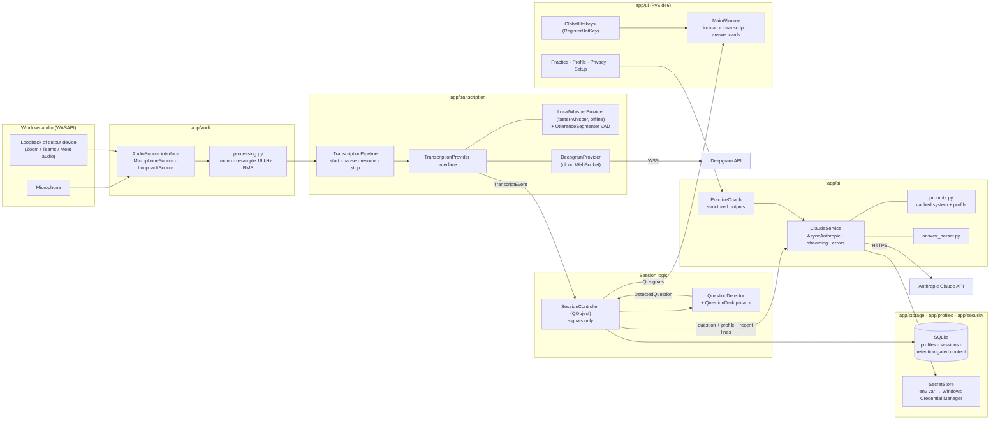

# Architecture

## Component diagram

## Threads

| Thread | Work | Talks to UI via |
|---|---|---|
| GUI (main) | Widgets, controller state | – |
| PortAudio callback (one per device) | Convert frames → mono float32, hand to pipeline | – (never touches Qt) |
| `whisper-worker` | Speech-to-text inference; stale interim jobs are skipped | `AsyncRunner.on_gui` (queued signal) |
| `stt-poll` | Finalizes utterances when loopback audio stops arriving | – |
| `asyncio-loop` | All Claude API calls (`AsyncAnthropic`), Deepgram uses its own loop thread | `AsyncRunner.submit` callbacks (queued) |
| short-lived workers | Pipeline start (model load) / stop / pause | `AsyncRunner.run_in_thread` callbacks |

The UI thread never blocks on audio, model loading, or network I/O. Streaming answer
updates are throttled to ~12/s.

## Data flow for one question

1. Interviewer speaks → loopback frames → resampled to 16 kHz → `UtteranceSegmenter`.
2. Interim segments (every 1.5 s) give live text; a final segment is emitted after 700 ms of
   silence, after 15 s, or when audio stops arriving.
3. Final `TranscriptEvent` → `QuestionDetector` splits sentences, recognises questions,
   attaches the preceding sentence as lead-in context, classifies the category, and drops
   duplicates (Jaccard / sequence similarity ≥ 0.82 within 10 min).
4. `ClaudeService.stream_answer` sends: fixed system prompt (cached) + profile block
   (cache breakpoint) + recent transcript lines + question + mode/length instructions.
5. Streamed text is parsed incrementally into the card: answer, key points, profile
   example, context quality, and missing-personalisation list.

## Design decisions

* **No FastAPI service.** Everything runs in one process. A local HTTP service would add an
  open port and attack surface without enabling anything the in-process design cannot do.
  The provider interfaces are where a future service boundary would go.
* **Platform-independent capture.** Zoom, Teams and Meet all play audio through a Windows
  output device; WASAPI loopback captures it with no platform API, account, or bot. No
  meeting-platform integration is claimed (see `FEATURE_MATRIX.md`).
* **Speaker attribution by source.** Loopback = interviewer, microphone = you. This is
  reliable without diarization and lets question detection ignore your own speech.
* **Local STT by default.** Audio stays on the PC unless the user selects Deepgram.
* **Temperature → effort.** Since API version `2026-10-21` the Messages API rejects
  `temperature`/`top_p`/`top_k` on every model; the configurable knob is reasoning effort.
* **Prompt caching.** The static instructions and the session-stable profile come first so
  repeated questions read the profile from cache (`cache_read_input_tokens`).
* **Refusal fallback.** On Opus 5.5 / Sonnet 5.5 the request includes `fallbacks: "default"`
  (beta `server-side-fallback-2026-07-01`); it can be disabled in Settings.
